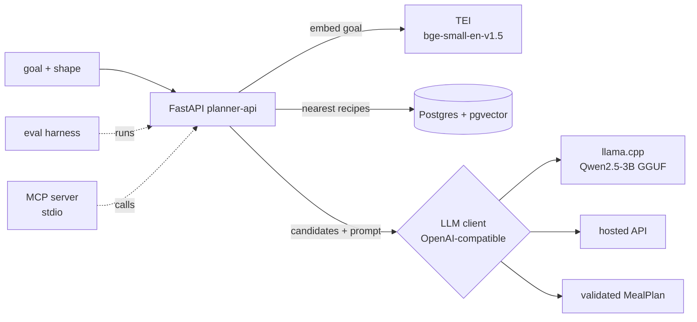

# Hungry — Project Plan

A meal-planning app built to learn applied LLM engineering. The domain is deliberately
simple so the focus stays on the AI pipeline: retrieval, grounded generation, structured
output, evaluation, and comparing model backends.

## Goal

Given a free-text goal (e.g. "high-protein vegetarian dinners, under 30 min") and a shape
(days, meals per day), return a structured meal plan built only from recipes in the
database, and measure how good that plan is.

- RAG over ~180k recipes (Food.com) with pgvector
- Grounded generation: the LLM may only pick from retrieved candidates, and every pick is checked
- Structured output that validates against a schema
- An eval harness that measures quality, not just "it returned JSON"
- Interchangeable LLM backends behind one OpenAI-compatible client: local llama.cpp,
  a hosted API (Claude/OpenAI), and any other OpenAI-compatible server

## Architecture

## Locked decisions

| Area | Choice | Why |
|---|---|---|
| Embeddings | TEI + bge-small-en-v1.5 | 384-dim, fast on CPU, solid baseline for short recipe text |
| Vector store | Postgres + pgvector | Retrieval stays in plain SQL next to the recipe data |
| Local LLM | llama.cpp server, Qwen2.5-3B-Instruct Q4_K_M | Runs on CPU, OpenAI-compatible API, small enough to iterate fast |
| Hosted LLM | Claude or OpenAI, via the same client | Quality and latency ceiling to compare against |
| Dataset | Food.com RAW_recipes (Kaggle, ~180k) | Real ingredients, times and tags |
| Output contract | JSON mode + Pydantic validation, one retry on failure | Malformed output fails loudly instead of leaking downstream |

## Phases

### Phase 0 — RAG baseline (done)
Ingest a slice of recipes with embeddings. Vector retrieval feeds candidates to the LLM,
which returns a plan that validates against `MealPlan`. The backend is a config switch
(`LLM_BACKEND=llama|hosted`).

### Phase 1 — Retrieval quality
- Build a small labeled set: goal → recipes that should come back
- Measure recall@k for the current setup
- Try: different embedding text (name only vs. name + tags + ingredients), larger ingest
  slices, hybrid lexical + vector search, structured filters (minutes, tags) pulled from
  the goal, cross-encoder reranking
- Decide the full-ingest question with numbers

### Phase 2 — Grounding and constraints
- Enforce grounding in code: drop or flag any meal whose `recipe_id` is not in the
  candidate set. Today the prompt asks for this and nothing checks it.
- Check hard constraints after generation: time limit, day and slot counts, diet tags
- Replace retry-on-bad-JSON with schema-constrained decoding where the backend supports it
  (llama.cpp does)
- Define what the API returns on partial failure

### Phase 3 — Evals
- A fixed set of ~50 goals, each with expected shape and constraints
- Automatic checks: schema-valid, grounded, constraints met, no duplicate meals in a plan
- LLM-as-judge for the subjective `why` lines, with the judge prompt versioned and
  spot-checked by hand
- Run on every prompt or model change, and keep results in the repo so regressions show up

### Phase 4 — Backend comparison
- Same eval set against local llama.cpp and the hosted API
- Report quality, latency, token usage and cost per plan
- Log each call (prompt, response, tokens, latency) to JSONL to start. A tracing tool
  such as Langfuse can come later if the volume justifies it.

### Phase 5 — Tool use
- Thin stdio MCP server exposing `create_plan` and `swap_meal`
- `swap_meal` is the interesting one: replace a single meal while keeping the rest of the
  plan consistent with the constraints
- Evaluate the tool layer with the same harness

### Phase 6 — Prompt and model iteration (open-ended)
Prompt versioning, few-shot examples drawn from accepted plans, and possibly fine-tuning a
small model on them if evals show a gap worth closing.

## Out of scope

- Deployment, container orchestration, CI/CD, cloud infrastructure, GPU provisioning
- Infrastructure observability (metrics dashboards, cluster monitoring)
- The Next.js UI from the original plan. The API and the MCP server are the interfaces.

Docker Compose stays as the local way to run the AI dependencies (Postgres, TEI, llama.cpp,
the API). It is not a deployment target.
